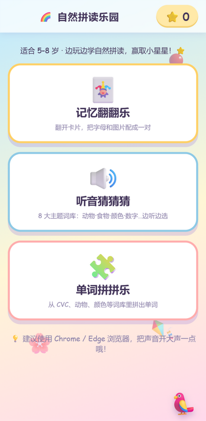
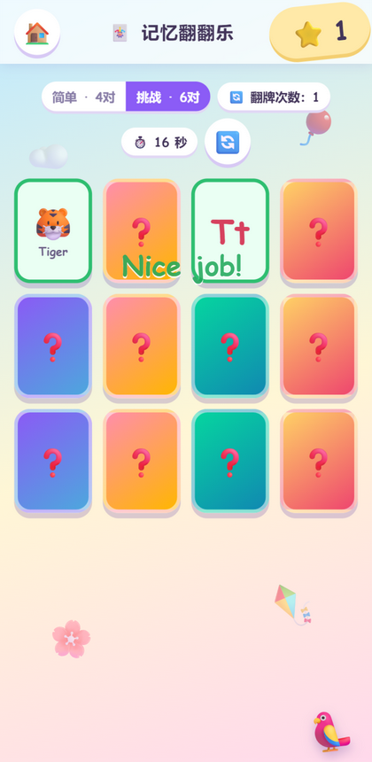
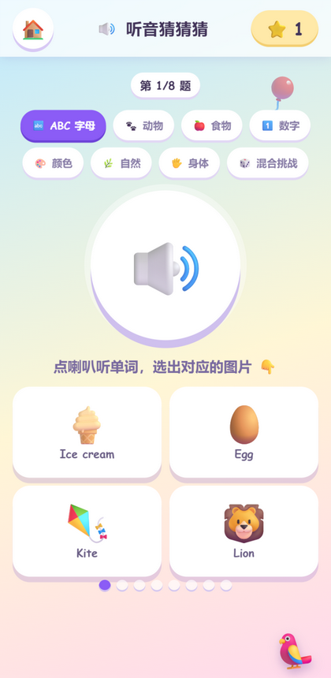
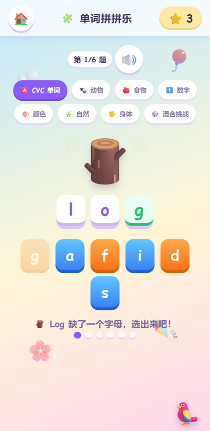

# 🌈 Phonics Fun · 自然拼读乐园

### Play first, reading follows. 先玩起来，拼读跟上来。

**Completed Demo · 已完成小样演示** — three complete phonics mini-games in a single HTML file. Open it in a browser and have a go: nothing to install, no registration and no charge.

三个已经做完的自然拼读小游戏，装在一个 HTML 文件里。用浏览器打开就能玩：不用安装，不用注册，完全免费。

Tap a card, listen to the English word and find its partner. The game reads words aloud and awards little stars, and runs on an ordinary phone or an old laptop.

孩子点开一张卡片，听到一个英文单词，再找到它的另一半——游戏会朗读单词、发小星星奖励，并且在一部普通手机或旧电脑上就能流畅运行。

[Play / 玩法](#screenshots--项目截图) · [What's inside / 三个游戏](#whats-inside--里面有什么) · [Run / 运行](#how-to-run--怎么运行) · [Technology / 技术](#technology--技术) · [Honest status / 如实说明](#honest-status--如实说明)

## Why build this? / 为什么做

Learning shouldn’t need a top-of-the-range phone. Many children starting to learn English use a shared or older device. That’s why this demo comes as a single HTML file: it opens in any browser, works offline once loaded and reads each word aloud using the device’s built-in voice.

学习不该需要一台旗舰手机。许多刚开始接触英语的孩子手边只有共用或老旧的设备——所以这个小样只做成了一个 HTML 文件：任意浏览器都能打开，加载之后离线也能玩，发音用的是设备自带的声音。

Our design principles / 设计上守住的几条：

- **Play before drill. / 先玩，再练。** Matching, guessing and building come first, with phonics woven into the play. / 每个玩法先是一个游戏——配对、猜词、拼字——拼读藏在里面。
- **Instant, audible feedback. / 即时、听得见的反馈。** Get an answer right and the game reads the word aloud and awards a star. Get it wrong and you can simply have another go, with no penalty. / 答对会朗读单词并奖励星星；答错可以再试，不惩罚。
- **Zero barrier to entry. / 零门槛。** No account, no reliance on a network connection, no data collection and no adverts. / 无账号、不依赖网络、不收集数据、没有广告。

## What's inside / 里面有什么

| Game / 游戏 | How to play / 怎么玩 | What to practise / 练什么 |
| --- | --- | --- |
| 🃏 Memory Match 记忆翻翻乐 | Turn over cards to match a letter with an illustrated word, such as `Jj` ↔ 🧥 Jacket. Choose 简单 · 4对 (easy, four pairs) or 挑战 · 6对 (challenge, six pairs). / 翻牌把字母和图片词配成一对，如 `Jj` ↔ 🧥 Jacket。可选 4 对或 6 对难度。 | Letter shapes and the meanings of illustrated words / 字母形态与图片词义 |
| 🔊 Listen & Guess 听音猜猜猜 | Tap the speaker, listen to the English word and choose the matching picture from four options. / 点喇叭听单词，从四张图片里选出对应的一个。 | Connecting sounds with meanings; listening and recognition / 声音与词义的连接、听辨 |
| 🧩 Word Builder 单词拼拼乐 | Look at the emoji beside a word with a missing letter, then choose the right tile to complete 🪵 `l·o·[g]`. / 单词缺一个字母，看图选出正确的字母块补全单词。 | Spelling and CVC word patterns / 拼写与 CVC 词型 |

**Word banks / 词库：** 26 illustrated alphabet words (A-Apple 🍎 … Z-Zebra 🦓) · around 24 CVC words (cat, sun, pig…) · 8 themed word banks in both the listening and spelling games: letters, CVC, animals, food, numbers, colours, nature and the body — plus a mixed challenge / 两个游戏各有 8 个主题词库：字母、CVC、动物、食物、数字、颜色、自然、身体，另有混合挑战。

**Feedback loop / 反馈循环：** Each correct answer earns a ⭐ star, saved in `localStorage`. A timer records the time taken, a turn counter records card-flipping attempts, and completing a round brings up a 🏆 celebration before the next one.

每答对一题奖励 ⭐ 小星星（保存在浏览器本地），计时器记录用时，翻牌计数记录尝试次数，完成一轮会弹出 🏆 庆祝弹窗再进入下一轮。

A little 🦜 companion stays nearby and chats to the child along the way. / 一只 🦜 小鸟陪在一旁，随时跟孩子说句话。

## Screenshots / 项目截图

All screenshots are in [`docs/screenshots/`](docs/screenshots/).

所有截图都在 [`docs/screenshots/`](docs/screenshots/) 目录。

1. 
   **Home menu / 主菜单** — the three games, a star counter and an age guide on a phone-sized screen. One tap gets things going. <br> 手机尺寸下的主菜单：三个游戏入口、星星计数和适合年龄提示。从这里一下就能开始。

2. 
   **Memory Match 记忆翻翻乐** — a matched pair (`🐯 Tiger` ↔ `Tt`) stays face up with a green border and adds a star. The difficulty options, turn counter and timer sit above the grid. <br> 一对配对成功（`🐯 Tiger` ↔ `Tt`）的卡片带绿框保持翻开，星星 +1；上方是难度选择、翻牌次数和计时。

3. 
   **Listen & Guess 听音猜猜猜** — 8 themed word banks across the top, a large speaker button to hear the word, and four pictures to choose from below. Progress dots show the current question (第 1/8 题). <br> 顶部是 8 个主题词库，中间的大喇叭朗读单词，下方四选一；圆点进度显示当前第几题。

4. 
   **Word Builder 单词拼拼乐** — with the CVC word bank selected, 🪵 `l·o·g` completed in green, and the remaining letter tiles below. The correct letter stays in place and the game reads the whole word aloud. <br> 选中 CVC 词库，🪵 `l·o·g` 补全成功（绿色高亮），下方是待选字母块。选对了字母会锁定并朗读整词。

## How to run / 怎么运行

**Easiest / 最简单：** download `index.html` and open it in a modern browser. Chrome or Edge are recommended for the best read-aloud experience. / 下载 `index.html`，用现代浏览器打开即可——推荐 Chrome 或 Edge，朗读效果最好。

**Local server (optional) / 本地服务（可选）：**

```bash
python -m http.server 8123
# then open / 然后打开 http://127.0.0.1:8123/
```

Once loaded, it works entirely offline and adapts to phone, tablet and computer screens. / 加载完成后可完全离线运行，适配手机、平板和电脑屏幕。

## Technology / 技术

| Choice / 选择 | Why / 原因 |
| --- | --- |
| Single `index.html` / 单文件 | No build step, no framework, no dependencies — easy to share, easy to run anywhere / 无构建、无框架、无依赖，随处可跑 |
| Browser speech synthesis / 浏览器自带语音 | Words are read aloud using the built-in English voice (`en-US`) at a slower pace for children; there are no audio files to download / 用设备自带英文语音朗读，语速放慢适合儿童，无需下载音频 |
| Emoji as art / Emoji 当美术素材 | Colourful visuals without separate image files keep the download small / 不带任何图片资源，文件小、画面依然丰富 |
| `localStorage` for stars / 星星本地保存 | Progress stays on the child’s device; no data is uploaded / 进度只留在设备上，不上传任何数据 |

## Where it sits / 项目定位

This is a small example of the learner materials produced for [Learning Infrastructure](https://github.com/K-LIU2016/learning-infrastructure) — interactive HTML practice a child can open directly, designed with accessibility first: any device, any family, no set-up.

它是 [Learning Infrastructure](https://github.com/K-LIU2016/learning-infrastructure) 在学生端交付上的一个小样——孩子能直接打开的交互式 HTML 练习，第一原则是可及性：任何设备、任何家庭、零配置。

## Honest status / 如实说明

- This is a complete game demo rather than a full curriculum. It offers practice with letters, listening and CVC spelling through play; it does not yet record a learning pathway, and learning outcomes have not been evaluated. / 这是一个已完成的游戏小样，不是课程体系：它通过游戏练字母、听辨和 CVC 拼写，尚无学习路径记录，也未验证学习效果。
- Speech quality depends on the device’s built-in English voice. Chrome and Edge on a computer give the best results; some phones do not have an English voice installed. / 发音质量取决于设备自带的英文语音——电脑版 Chrome/Edge 最好；部分手机没有安装英文语音包。
- Stars are saved in the browser; synchronisation across devices is deliberately not included. / 星星按浏览器保存，设计上不做跨设备同步。

## Discuss / 交流

Ideas, classroom needs or a story about playing the game with a child are all welcome in Issues. Please leave children’s personal details out of your posts.

想法、课堂需求，或者你陪一个真实孩子玩它的故事——都欢迎通过 Issues 交流。请勿提交儿童个人信息。
